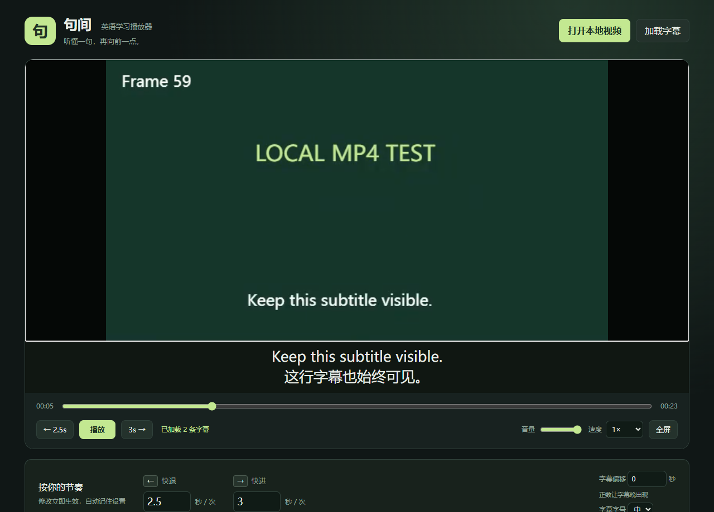

# 句间 · 英语学习播放器

双击「启动播放器.cmd」或 index.html，用 Edge / Chrome 打开。无须安装、联网或启动服务器，视频不会上传。

1. 点击「打开本地视频」，选择 MP4；也可直接拖入。
2. 点击「播放」，按键盘 **←** 快退、**→** 快进，默认各 10 秒。
3. 下方分别修改快退、快进秒数，立即生效，支持 0.1～3600 秒。编辑数字后按 Enter 或点击画面，回到播放器快捷键。
4. **空格** 播放 / 暂停，**F** 进入 / 退出全屏，**Esc** 退出全屏。长按方向键会连续跳转。
5. 如果字幕本身在视频画面里，直接观看即可。另有 SRT / VTT 文件时，点击「加载字幕」，字幕显示在视频下方；支持多行中英文和字幕偏移。正偏移让字幕晚出现。字幕文件应为 UTF-8。

进度条、跳转提示和播放按钮始终在画面之外，全屏也不会覆盖画面里的字幕。修改数字输入框时，方向键用于编辑数字；按 Enter 后恢复跳转。

## 支持范围

- 推荐 Edge / Chrome，MP4 常见 H.264 视频 + AAC 音频。能否播放取决于浏览器和系统的编码支持；不支持的编码会显示错误提示。
- 支持烧录在画面中的字幕及另载 SRT / VTT；暂不读取 MP4 内封装的可选字幕轨。字幕样式和定位标记会转换为纯文本。
- 本地设置尽可能保存在浏览器中；浏览器若限制 file:// 存储，当前窗口仍可使用设置。
- 更换视频会清空外置字幕，避免字幕与新视频错配。视频需重新选择，不会记录本地文件路径。
- 不含转码、自动生成字幕、字幕翻译，也不需要付费服务。

## 文件

index.html 是入口，style.css 为样式，app.js 为播放器逻辑。请保留在同一文件夹内。

## 下载与开发

点击 GitHub 的 Code → Download ZIP，完整解压后打开 `index.html`。运行无需 Node 或依赖安装。

修改代码后，可在安装了 Node.js 与 Chrome 的电脑执行：

```sh
npm install
npm test
```

测试使用 Chrome MediaRecorder 自动生成合成视频，验证真实解码、跳转、字幕和布局。测试样片、字幕和输出保存在已忽略的 `verification/` 中；不附带用户视频。

## 作品分类

本项目使用 GitHub Topics 标记用途。同系列公开项目：

| 类别 | 项目 |
| --- | --- |
| 图像与创作 | [拾光修图](https://github.com/JiaDongZou/photo-studio) |
| 英语与学习 | [句间英语播放器](https://github.com/JiaDongZou/english-study-player) |
| AI 与电商分析 | [CBEC 推荐与运营分析](https://github.com/JiaDongZou/cbec-recommendation-assistant) |
| 生活与微信小程序 | [我的私人食谱](https://github.com/JiaDongZou/recipe-miniprogram) |


